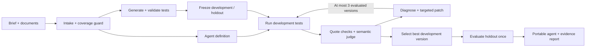

# ForgeAI

Build, evaluate and repair document-grounded agents using a local model.

A brief and a document folder go in. A portable agent definition, generated tests, a bounded repair history and an honest quality report come out. The factory runs on a small open model through llama.cpp or Ollama. No paid API or hosted database is needed.

The implementation deliberately uses a small Python state machine rather than a large orchestration framework. Source ingestion, retrieval, tool permissions, judging and repair can be inspected independently.

## Start here

Python 3.11 or later is required.

```powershell
python -m venv .venv
.venv\Scripts\python -m pip install -e .
```

Start a local inference service in another terminal. With Ollama:

```powershell
ollama pull qwen3:4b-instruct-2507-q4_K_M
ollama serve
```

If Ollama is already running, do not start a second service. Then run:

```powershell
.venv\Scripts\python -m forgeai build --brief examples/workshop/brief.txt --docs examples/workshop/docs --out artifacts/my-workshop --endpoint http://127.0.0.1:11434 --model qwen3:4b-instruct-2507-q4_K_M
.venv\Scripts\python -m forgeai chat --agent artifacts/my-workshop/agent.json --endpoint http://127.0.0.1:11434 --model qwen3:4b-instruct-2507-q4_K_M
```

The development machine also uses a project-local llama.cpp server. If its ignored runtime files are present, `scripts/start-local-model.ps1` starts it on loopback port 8080. With llama.cpp the default endpoint is `http://127.0.0.1:8080/v1` and model alias is `qwen3-4b-instruct-2507`.

## Unseen brief review

Write the reviewer's paragraph to a UTF-8 text file and point the factory at their document folder:

```powershell
python -m forgeai build --brief review/brief.txt --docs review/documents --out artifacts/unseen-run
python -m forgeai chat --agent artifacts/unseen-run/agent.json --question "Your question here"
```

Use a new output directory for each run. The factory refuses to overwrite previous evidence. Default intake is unattended: it records up to five proposed questions and conservative assumptions, then proceeds within supported scope. Add `--interactive` to ask the questions in the CLI. A completely unsupported request stops at requirements rather than creating an agent with invented capabilities.

Supported inputs: text-based PDF, UTF-8 `.md`, `.txt`, and `.csv`. At least two readable documents with twelve distinct factual statements are needed for the current evaluation design. Scanned PDFs require OCR before use. Limits: 200 files, 20 MB per file, 1 MB extracted text; small, English-language corpora are the intended use case.

## What a run contains

| Artifact | Purpose |
|---|---|
| `requirements.json` | Scope, audience, tone, clarifications, assumptions, per-topic coverage and gaps |
| `agent.json`, `agent.vN.json` | Selected definition and every evaluated version |
| `corpus.json`, `documents/` | Portable evidence, stable chunk IDs and source hashes |
| `evals.json` | 24 generated cases, verified source quotations, fixed development/holdout split |
| `scorecard.vN.json` | Every response, retrieval trace, tool result, judgment and failure category |
| `scorecard.holdout.json` | Six held-out cases evaluated once after selection |
| `changes.json` | Targeted patches, before/after scores, improvements, regressions and acceptance |
| `model_calls/`, `prompts/` | Raw local requests/responses and the prompts used in this run |
| `state.json`, `usage.json`, `report.md` | Completion status, resource usage and remaining limitations |

Read `state.json` before trusting any score. A partial run is not a completed demonstration. An agent may already be runnable even if evaluation generation fails, but its quality is then **unvalidated**.

## How it works



The registry exposes three read-only tools: exact CSV lookup, bounded arithmetic and the current UTC date. A separate local-model step selects tools from the brief; the factory rejects unknown tools and CSV lookup without a CSV source. Every actual invocation is checked against that agent's allowlist. Whether a selected tool is necessary remains a model judgment, so reviewers should inspect the recorded brief and selection.

The test generator first samples distinct verbatim facts, spread across source documents, then asks the local model to write focused questions. Cross-document questions receive two nonredundant source facts; refusal and ambiguity questions have explicit generation tasks. Every question is generated at runtime. A frozen, stratified split keeps six cases out of optimization.

The judge combines deterministic checks (schema, quote occurrence, citation visibility, status) with anonymous, criterion-based model scoring. Expected facts are never passed to the answering agent. The optimizer cannot insert test answers: it chooses from small, generic patches. A non-improving patch is rejected and stops the loop; regressions are recorded even when aggregate score improves.

## Budget and failure behavior

`--iterations` is 1–3, including the initial evaluation. `--token-budget` defaults to 300000 and `--seconds` to 10800. Each request reserves a conservative character-based input estimate plus its output cap; actual usage replaces that estimate when available. This may stop early rather than overspend. `--timeout` bounds individual requests. No silent mock fallback exists.

Malformed JSON gets one retry. Unverifiable generated test facts are rejected with bounded regeneration. Fabricated answer citations cause a visible refusal and a recorded guard failure. Missing models, exhausted budgets and invalid corpora produce a nonzero exit code and an incomplete report where a run directory has been created.

## Demonstrations and validation

- Workshop: prose policies, explicit unsupported guest-access topic, refund boundaries and safety refusals. No external tools should be needed.
- Coastal procurement: CSV + supplier policies, exact SKUs, pack units, arithmetic, supplier-specific conditions and deliberately missing live inventory/tax information.

Both corpora are fictional. Their synthesis instructions are in `examples/SYNTHESIS.md`. Evaluation questions are generated by the local model at runtime; they are not hand-written demo scripts.

With the reference local model server running, reproduce both demos in a new directory using `python -m scripts.run_demos --out runs/reproduction`. This preserves the committed reference artifacts.

On Windows the CLI and demo script request temporary prevention of automatic system sleep while working. They release that request on exit; manual sleep or closing the laptop can still interrupt a run.

```powershell
python -m unittest discover -s tests -v
```

Unit tests use clearly named stubs only to test failure paths. They are not demonstration runs or model-quality evidence. See `docs/ARCHITECTURE.md` for tradeoffs and `docs/OWNERSHIP.md` for the candidate review checklist.

## Known boundaries

This is a prototype for small document collections. BM25 can miss semantic paraphrases; PDF extraction can lose table structure. The same small model generates tests and supplies semantic judgments, so correlated errors remain despite deterministic guards and a holdout split. Generated test labels and groundability claims need human inspection. The runner treats questions independently; it does not provide conversational memory, write actions or live inventory.

All model transcripts are stored locally. Review them before sharing a run containing private documents. Model weights and runtime binaries are excluded from Git. Source documents supplied for this assessment are not copied into the repository.


